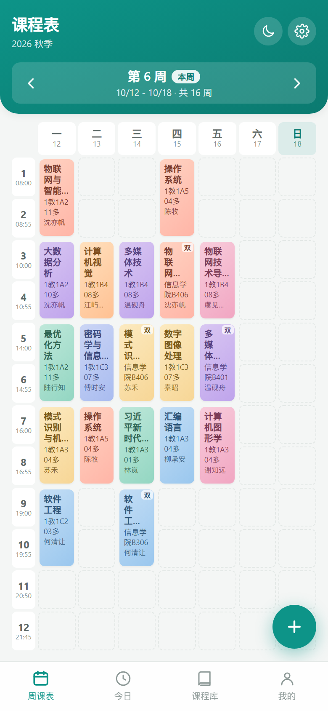

# 课程表应用

面向大学生的每周课程管理工具。**同一份业务逻辑，交付了网页版和微信小程序两个可运行形态**，数据全部保存在本地，不依赖任何后端服务。



## 功能

| 编号 | 功能 | 说明 |
|------|------|------|
| F01 | 课程登记 | 名称 / 教师 / 地点 / 星期 / 起止节次 / 起止周次 / 颜色，字段级校验 |
| F02 | 周课表展示 | 7 列 × 节次的网格，跨节次的课程渲染为**一整块连续色块**，块内显示课程名、地点、教师 |
| F03 / F04 | 编辑 / 删除 | 点击格子即编辑（字段预填），删除前二次确认 |
| F05 | 周次导航 | 依据开学日期自动推算当前周，可前后翻页，支持「回到本周」 |
| F06 | 数据持久化 | 每次增删改立即落盘，冷启动自动恢复；数据损坏时优雅降级为初始数据 |
| F07 | 今日课程 | 独立页面，按节次顺序列出当天课程 |
| F08 | 空状态引导 | 无课程时展示引导文案与「载入示例数据」入口 |
| F09 | 冲突检测 | 保存时检测「同星期 + 节次重叠 + 周次重叠」，提示后允许用户确认继续 |
| F10 | 颜色标记 | 8 组柔和渐变色板，**按课程名分配**——同一门课无论拆成几条记录，永远同色 |
| F11 | 课程库 | 列表浏览全部课程，支持编辑与删除 |
| F12 | 一键清空 | 设置页入口，二次确认 |
| F13 | 深色模式 | 主题偏好持久化，小程序端同步切换导航栏配色 |
| F14 | 数据导入导出 | 导出 JSON 备份、导入 JSON 恢复 |
| F15 | 上课提醒 | 提前 N 分钟提醒（小程序端走订阅消息，需配置模板 ID） |
| F16 | 学期参数 | 学期名称、开学第一周的周一、总周数均可改 |
| F17 | Toast 提示 | 所有变更操作给出非阻塞反馈 |
| F18 | **智能导入** | 粘贴教务系统复制的课表文字，自动解析出星期、节次、周次、地点、教师，先进入可编辑预览再批量写入 |
| F19 | 节次作息可配置 | 每节上下课时间可改，节次数 4~16 可增删；删除被引用的节次会拦截并提示 |

## 两个子工程

| 目录 | 形态 | 技术栈 | 规模 |
|------|------|--------|------|
| `web/` | 网页版，手机浏览器访问 | React 18 + TypeScript + Vite 5 | 23 个源文件，约 5600 行 |
| `miniprogram/` | 微信小程序，真机预览 | Taro 4.3 + React 18 | 26 个源文件，约 5800 行 |

两者**共用同一套纯函数逻辑层**（`importParser` / `course` / `date` / `storage` / `id`）——这些模块不碰 DOM、不碰存储，因此能同时跑在两个端上；只有视图标签和最底层的存储调用各自适配。

### 网页版

```bash
cd web
npm install
npm run dev      # 开发服务器，--host 后手机可访问
npm run build    # 产物在 web/dist
```

### 小程序版

```bash
cd miniprogram
npm install
npx taro build --type weapp    # 产物在 miniprogram/dist
```

然后用**微信开发者工具**导入 `miniprogram/dist` 目录（不是工程根目录），AppID 选「测试号」即可真机预览。个人主体不需要备案。

> 微信小程序版有一份独立的 [miniprogram/README.md](miniprogram/README.md)，记录了从网页版迁移时踩过的坑（CSS 兼容、标签映射、图标方案等）。

## 智能导入是怎么工作的

不是 OCR，也没有调用大模型——是一个 **395 行的手写规则解析器**（`web/src/utils/importParser.ts`，`miniprogram/src/utils/importParser.ts` 同款），零第三方依赖、离线可用。

核心机制叫**消费式抽取**：八个字段抽取器按固定顺序依次工作，每个命中后就把那段文字从字符串里删掉，下一个抽取器面对的是被啃过的剩余文本，最后剩下的就是课程名。抽取器的顺序是硬编码的（比如地点必须早于「行尾裸姓名」规则），顺序错了会互相抢文本。

解析不出的字段填默认值并写进 `issues`，**所有结果必须先过一遍人的眼睛**——预览页每一行都可以改、可以不勾选。这是不引入云端服务的前提下，保证导入可靠性的关键设计。

## 目录结构

```
course-schedule/
├── README.md              本文件
├── docs/
│   ├── requirements.md    软件需求规格说明书 v2.1（10 章，19 个编号功能）
│   └── screenshots/       效果截图
├── web/                   网页版工程
│   ├── src/
│   ├── docs/              
│   ├── prototype/         早期 HTML 原型
│   └── scripts/           验证脚本
└── miniprogram/           微信小程序工程
    ├── src/
    ├── config/
    └── scripts/
```

## 文档

- **[需求规格说明书](docs/requirements.md)** —— 10 章，含修订记录、术语表、数据模型、组件树、Props 契约、用例流程、验收清单、里程碑验证记录。19 个功能全部编号（F01–F19），每条都有用户故事和验收标准，代码能对回文档。

## 数据与隐私

- 所有课程数据保存在设备本地（网页版走浏览器本地存储，小程序版走微信本地存储），**不上传任何服务器，不采集任何个人信息**。
- 数据格式带版本号（`DATA_VERSION = 3`），旧版本数据打开时会自动规范化升级。
- 换设备时需要手动「导出 JSON → 导入 JSON」。这是主动取舍：课程表是单人单机工具，上云解决的是多端同步和多人协作，本项目没有这个需求（理由见需求文档 §10.2）。

## 已知边界

- 单学期设计，换学期需要改设置或清数据重录。
- 小程序端的上课提醒要真正推送，需在小程序后台申请订阅消息模板，把模板 ID 填进 `miniprogram/src/constants.ts` 的 `NOTIFY_TEMPLATE_ID`。留空时开关可用但会明确提示未接通，不假装成功。
- 教师字段对「多教师连写」（如「虞见川骆知微」）只做原样导入，需要在预览页手动分隔。
